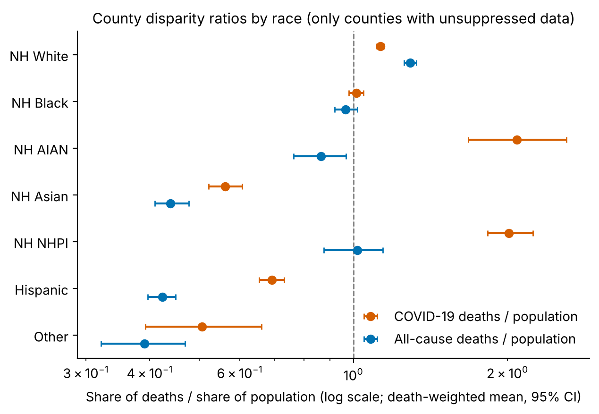
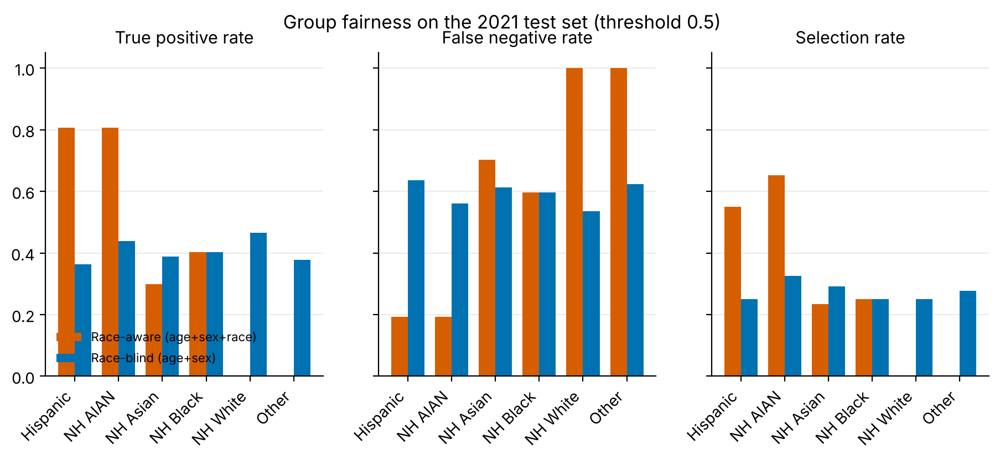

# COVID Bias Audit

*Auditing how biased data and modelling choices affect machine-learning results on COVID-19 mortality data.*

This project checks whether the data and modelling choices behind COVID-19 mortality analyses distort
what machine-learning models conclude about demographic groups (race and ethnicity, education, age and sex).
It began as an undergraduate research study (EST 441, Interdisciplinary Senior Project, advised by
Dr. Elizabeth Hewitt). It has since been rebuilt as a reproducible, tested Python package.

The original paper ([`docs/paper/`](docs/paper/ai-racism-final-paper.pdf)) used random-forest feature
importance and an SVM on CDC data. The rebuild re-runs those pipelines alongside corrected ones. Several
headline metrics turned out to come from methodological errors, not real signal, and the corrected
analyses tell a different story. The [methodology notes](docs/methodology.md) document each error and its fix,
and the [errata](docs/paper/ERRATA.md) lists the corrections claim by claim against the paper.

## Key findings

| | Original analysis | Corrected analysis |
|---|---|---|
| **Education × race model** | R² = **0.918** on one random split | Same model across 50 split seeds: R² from **−0.53 to 0.99**. Repeated 5-fold CV on a rate target: **0.67 ± 0.19** |
| **County model** | R² = **0.506**, "Large central metro" most important | Model predicted county *size* (raw death counts). On a rate target with state-grouped CV: **no out-of-sample skill** (R² ≈ −0.12, below a mean baseline) |
| **Risk classifier** | Accuracy = **0.75** | Majority baseline is **0.61**. The label double-counted COVID deaths (7 rows had a COVID share > 100%) |
| **"Sex does not matter"** | Sex-only SVM accuracy 0.61 | The SVM predicted a single class for everyone. Its accuracy *is* the baseline |

What the corrected analyses show:

1. **Race is strongly associated with COVID mortality after adjusting for education, age and sex.**
   In a quasi-binomial GLM, the odds that a death was due to COVID-19 (vs NH White) are
   **3.17× for Hispanic** (95% CI 2.94–3.41), **2.73× for NH American Indian/Alaska Native**
   and **1.72× for NH Black and NH Asian** decedents. Education has a much smaller effect: HS or less vs
   bachelor's+ gives OR 1.17.
2. **Crude population-share comparisons hide this disparity.** Across 1,229 counties, Hispanic residents'
   share of COVID deaths is *lower* than their population share (ratio 0.69), because the Hispanic
   population is younger. Compared with all-cause deaths, however, they are **1.57× over-represented**
   among COVID deaths. A model or dashboard built on the naive ratio would point the wrong way.
3. **"Fairness through unawareness" doesn't work, and neither does adding race.** In a hypothetical
   screening model that flags high-COVID-burden demographic groups, trained on 2020 and tested on 2021:
   - The **race-aware** model gains only +0.03 AUC. It flags **0% of NH White** cells,
     including the 24% that were truly high-burden (equalized-odds difference 0.81).
   - The **race-blind** model selects groups at similar rates. It misses **64% of high-burden Hispanic**
     cells vs 53% of NH White cells, because base rates differ by race.

<p align="center">
  
  
</p>

## Analyses

| Module | Question | Methods |
|---|---|---|
| `analysis/education.py` | How is race associated with COVID's share of deaths after adjusting for education (SES), age and sex? | Quasi-binomial GLM (odds ratios, 95% CI); random forest and ridge with repeated K-fold CV vs a baseline; held-out permutation importance |
| `analysis/county.py` | Are racial groups over-represented in county COVID deaths, and do county traits predict COVID mortality? | Disparity ratios with bootstrap CIs; rate target with `GroupKFold` by state; GLM with state-clustered SEs |
| `analysis/risk.py` | If a screening model were trained on this data, would it treat racial groups fairly? | Temporal split; train-only label threshold; logistic regression / gradient boosting vs baselines; per-group TPR, FPR, selection rate and calibration; demographic parity and equalized odds |
| `analysis/original.py` | How wrong were the original pipelines? | Faithful re-runs of the original code, with split-seed sensitivity |

## Quick start

```bash
git clone https://github.com/inukbaik/covid-bias-audit.git
cd covid-bias-audit
python -m venv .venv && source .venv/bin/activate
make install        # pip install -e ".[dev]"
make test           # pytest (about 15 s)
make reproduce      # all analyses -> reports/ (about 3 min)
```

Run a single analysis with `covid-bias run --analysis county --output reports`, or pass `--fast` for a quick run.

Outputs:
- `reports/figures/`: all figures
- `reports/tables/`: CSV tables behind every number above
- `reports/metrics.json`: headline metrics

## Project structure

```
data/raw/                 Raw CDC and BEA inputs (1.5 MB, unmodified)
src/covid_bias/
  config.py               Paths, seeds and analysis parameters
  data/                   Validated loaders (education, county + income join, monthly)
  evaluation/             Weighted and fairness metrics, CV and permutation importance, quasi-binomial GLM
  analysis/               One module per analysis, each exposing run(cfg, out)
  plotting.py             Shared colour-blind-safe figure style
  cli.py                  `covid-bias run` entry point
tests/                    Loader, metric, leakage and end-to-end smoke tests
reports/                  Generated figures, tables and metrics
docs/                     Methodology audit and the original paper
```

## Subdirectories & System Boundaries

- src: [`./src/README.md`](./src/README.md) - The source root. It contains
  [`covid_bias`](./src/covid_bias/README.md), which provides the CLI, the frozen
  `Config`, and the shared plotting style, and these subpackages:
  - [`data`](./src/covid_bias/data/README.md): validated loaders for `data/raw/`
  - [`evaluation`](./src/covid_bias/evaluation/README.md): metrics, CV, permutation
    importance, and the quasi-binomial GLM
  - [`analysis`](./src/covid_bias/analysis/README.md): the four `run(cfg, out)`
    analyses
- tests: Loader, metric, leakage, and end-to-end smoke tests (pytest). Test-only
  folder, so it has no contract file.
- data/raw, reports, docs: data, generated outputs, and prose. These folders hold no
  code, so they have no contract files.

## Global Invariants

- **Raw data is read-only.** Nothing in `src/` writes to `data/raw/`. Every loader
  checks columns, category sets, uniqueness, and count bounds, and raises
  `ValueError` on a mismatch. The exception is `analysis/original.py`, which reads
  the raw CSVs directly so it can reproduce the original errors.
- **Runs are reproducible.** All randomness comes from `Config.seed` (default 42).
  `original.py` hard-codes seed 42 to match the original code.
- **Category labels and reference levels are defined once**, in
  `src/covid_bias/config.py`.
- **Corrected analyses avoid leakage by design:**
  - county CV is grouped by state
  - the risk model trains on 2020, tests on 2021, and takes its label threshold from
    the training data only
  - monthly COVID deaths use only the multiple-cause column, never multiple plus
    underlying

## Global Side Effects

- **Reads:** the four CSVs in `data/raw/`.
- **Writes:** only to the output directory, which is `reports/` by default or set
  with `--output`:
  - `tables/*.csv`
  - `figures/*.png`
  - `metrics.json`, which is merged with any existing file rather than replaced
- **No network access**, no database, and no writes outside the output directory.
- **Global state:** matplotlib's global `rcParams` are changed while figures are
  made.

## System Verification

- Run: `make test` (runs `python -m pytest`)
- Full reproduction: `make reproduce`
- Lint: `make lint`

## Data

| File | Source | Unit of observation |
|---|---|---|
| `education_deaths.csv` | NCHS, [AH Deaths by Educational Attainment, 2019–2020](https://data.cdc.gov/NCHS/AH-Deaths-by-Educational-Attainment-2019-2020/4ueh-89p9) | Education × race × sex × age cell |
| `county_deaths.csv` | NCHS, [Provisional COVID-19 Deaths by County, and Race and Hispanic Origin](https://data.cdc.gov/NCHS/Provisional-COVID-19-Deaths-by-County-and-Race-and/k8wy-p9cg) | County (2020-01 to 2023-09) |
| `county_income.csv` | BEA, [Personal income per capita by county](https://www.bea.gov/data/income-saving/personal-income-county-metro-and-other-areas) | County (2020–2022) |
| `monthly_deaths.csv` | NCHS, [AH Monthly Provisional Counts of Deaths for Select Causes by Sex, Age, and Race](https://data.cdc.gov/NCHS/AH-Monthly-Provisional-Counts-of-Deaths-for-Select/65mz-jvh5) | Month × sex × race × age cell |

All data are aggregate counts, not individual records. Results describe groups and must not be read as
individual-level risk. NCHS suppresses counts of 1–9, so small groups (especially NH NHPI and NH AIAN)
appear only in counties large enough to report them.

## Limitations

- Disparity ratios are **crude, not age-standardised**. The data contain no age-by-race population
  denominators. The COVID-vs-all-cause ratio and the age-adjusted GLM partly address this.
- The education data cover 2020 only. The GLMs are heavily overdispersed (dispersion ≈ 54), and the
  standard errors are inflated to account for it.
- The screening model is a deliberately simple *hypothetical*, used to study how bias propagates. It is
  not a clinical tool. Its label is derived from outcomes (who died), which is itself a known source of
  label bias.

## License

Code is released under the [MIT License](LICENSE). The data come from U.S. government sources (CDC/NCHS, BEA)
and are in the public domain.

## Contact

Inuk Baik ([inuk.baik@gmail.com](mailto:inuk.baik@gmail.com))
